<!-- GitHub Profile README · LegendaCR · Ilya Matveevsky -->

  
  
  
  

 

## ◆ Обо мне

Fullstack-разработчик из Санкт-Петербурга (**СПбПУ, программная инженерия**). Последние ~2.5 года делаю коммерческие продукты под ключ: беру задачу на уровне бизнес-цели, проектирую архитектуру, пишу фронт и бэк, подключаю платежи, разворачиваю на своём сервере и поддерживаю после запуска.

Специализация — **экосистема Telegram**: боты, Mini Apps и SaaS-платформы с монетизацией. Плюс web-системы (CRM / CMS / личные кабинеты) и сайты.

<table>
  <tr>
    <td width="33%" valign="top">
      <b>🤖 Telegram-боты</b> 
      Платежи и Telegram Stars, FSM-сценарии, админки внутри бота, выдача доступа в каналы, антиспам
    </td>
    <td width="33%" valign="top">
      <b>📱 Mini Apps</b> 
      React-клиенты внутри Telegram, проверка <code>initData</code>, JWT, рейтинги, сезоны, монетизация
    </td>
    <td width="33%" valign="top">
      <b>💳 SaaS-платформы</b> 
      Подписки, тарифы, биллинг, вебхуки платёжных провайдеров, мультибот-архитектура
    </td>
  </tr>
  <tr>
    <td width="33%" valign="top">
      <b>🗂 Web-системы</b> 
      CRM / CMS, роли и права, личные кабинеты, документы и файлы, статистика
    </td>
    <td width="33%" valign="top">
      <b>🌐 Сайты</b> 
      Лендинги, корпоративные и многостраничные проекты с адаптивом и вниманием к деталям
    </td>
    <td width="33%" valign="top">
      <b>⚙️ Инфраструктура</b> 
      Linux, Docker, nginx, PM2, Cloudflare Tunnel, SSL, бэкапы, health-check, CI-скрипты деплоя
    </td>
  </tr>
</table>

 

## ◆ Стек

  
   
  
   
  

| Слой | Технологии |
| :-- | :-- |
| **Frontend** | TypeScript, React, Vite, React Router, HTML / CSS |
| **Backend** | Node.js, Express, REST API, JWT, Zod, FSM-сценарии |
| **Telegram** | Bot API, Telegraf, Mini Apps, Telegram Stars, webhooks |
| **Data** | PostgreSQL, миграции, бэкапы, XLSX-импорт, fuzzy-поиск (Fuse.js) |
| **DevOps** | Docker, nginx, PM2, Cloudflare Tunnel, Linux (Arch / Ubuntu) |

 

## ◆ Избранные проекты

<table>
  <tr>
    <td width="50%" valign="top">
      <h3>База Вердикта</h3>
      <b>Telegram Mini App · закрытое сообщество</b>
      
Навигационное приложение для участников сообщества Максима Вердикта: единая точка входа к разборам, подкастам, стримам и чатам вместо закрепов и ручного поиска.

      

        ▸ Bento-главная, поиск по материалам, вкладки «Чаты» / «Профиль» 
        ▸ Доступ по подписке на канал: <code>initData</code> → JWT 
        ▸ Встроенная и отдельная админ-панель, CRUD контента, медиа 
        ▸ Бот с Web App-кнопкой, webhook, health-check, бэкапы БД
      

      
<code>TypeScript</code> <code>React</code> <code>Express</code> <code>PostgreSQL</code> <code>Zod</code> <code>Telegraf</code>

      <a href="https://t.me/verdikt_menu_bot">→ @verdikt_menu_bot</a>
    </td>
    <td width="50%" valign="top">
      <h3>Attract Platform</h3>
      <b>Telegram SaaS · монетизация каналов</b>
      
Коммерческая платформа платных подписок на Telegram-каналы. Отвечал за архитектуру, backend, ботов и инфраструктуру запуска.

      

        ▸ SaaS-бот для владельцев каналов + Gatekeeper-боты для подписчиков 
        ▸ Тарифы, биллинг, несколько сценариев оплаты 
        ▸ Автоматическая выдача доступа, автокик, уведомления 
        ▸ Docker + nginx + Cloudflare Tunnel
      

      
<code>Node.js</code> <code>Express</code> <code>PostgreSQL</code> <code>Bot API</code> <code>Docker</code>

      <a href="https://t.me/attractsub_bot">→ @attractsub_bot</a>
    </td>
  </tr>
  <tr>
    <td width="50%" valign="top">
      <h3>Brain Train</h3>
      <b>Telegram Mini App · игры для мозга</b>
      
Тренировки памяти, внимания и логики: таймерные викторины, аркадные мини-игры, рейтинги и сезоны.

      

        ▸ Серверная валидация очков — защита рейтинга от накрутки 
        ▸ Монетизация: Telegram Stars + платёжный провайдер 
        ▸ Monorepo: Mini App, API, бот, лендинг 
        ▸ Миграции, платёжные вебхуки, скрипты выкладки
      

      
<code>TypeScript</code> <code>React</code> <code>Vite</code> <code>Express</code> <code>PostgreSQL</code> <code>nginx</code>

      <a href="https://t.me/braintrainru_bot">→ @braintrainru_bot</a>
    </td>
    <td width="50%" valign="top">
      <h3>Safronic</h3>
      <b>Бизнес-система · сборка мебели</b>
      
Сайт с личным кабинетом и два Telegram-бота, связанные общим backend: заявки из бота сразу появляются в ЛК.

      

        ▸ Сценарии заказа, сборки, замера и просчёта, проверка ИНН 
        ▸ Админка в боте: заявки, статусы, ответ клиенту 
        ▸ Бот-калькулятор по XLSX-прайсам с fuzzy-поиском 
        ▸ ЛК со статистикой и файлами
      

      
<code>React</code> <code>Express</code> <code>PostgreSQL</code> <code>Fuse.js</code> <code>xlsx</code> <code>Docker</code>

      <a href="https://safronic.ru">→ safronic.ru</a> · <a href="https://t.me/safroninc_bot">@safroninc_bot</a> · <a href="https://t.me/safronic_calc_bot">@safronic_calc_bot</a>
    </td>
  </tr>
</table>

<b>Ещё проекты</b>

 

| Проект | Что это | Стек |
| :-- | :-- | :-- |
| [**Legend Defense Bot**](https://t.me/Legend_defense_bot) | Антиспам для групп и каналов: фильтрация, нормализация текста против обходов, анти-мат | Node.js, Bot API |
| [**@all Bot**](https://t.me/Legend_all_bot) | Массовое упоминание участников чата по команде | Node.js, Bot API |
| **FunPay Automation** | Автоответы, автоподнятие лотов, периодические сообщения в чаты | Node.js |
| **CRM / CMS / сайты** | Внутренние системы управления и корпоративные сайты под заказ | React, Node.js, PostgreSQL |

 

## ◆ Как я работаю

- **Production-first.** Проект считается готовым, когда он задеплоен, мониторится и бэкапится, а не когда «работает у меня».
- **Безопасность по умолчанию.** Подпись Telegram `initData` проверяется на сервере, входные данные валидируются схемами (Zod), всё критичное (очки, доступы, платежи) считается на backend.
- **Платежи без сюрпризов.** Вебхуки с проверкой подписи и идемпотентной обработкой, понятные статусы, уведомления админам.
- **Владею всем циклом.** Архитектура → UI → API → БД → сервер → поддержка. Заказчику не нужно собирать команду под MVP.

 

## ◆ Активность

  

 

  <a href="https://t.me/Legenda_CR"><b>Обсудить задачу →</b></a>
  &nbsp;·&nbsp;
  <a href="https://legenda-store.ru">Портфолио и цены</a>
  &nbsp;·&nbsp;
  <a href="https://t.me/legasu">Канал с разборами</a>

  <i>Изучаю, создаю, автоматизирую. Делюсь опытом.</i>
   
  

