<!-- GitHub Profile README · LegendaCR · Ilya Matveevsky · EN -->

  

  
  
  
  

 

## ◆ About

Fullstack developer based in Saint Petersburg, studying **Software Engineering at Peter the Great St. Petersburg Polytechnic University (SPbPU)**. For the last ~2.5 years I've been building commercial products end to end: I take a business goal, design the architecture, write the frontend and backend, wire up payments, deploy to my own servers and keep things running after launch.

My focus is the **Telegram ecosystem** — bots, Mini Apps and SaaS platforms with built-in monetization — plus web systems (CRM / CMS / client dashboards) and websites.

<table>
  <tr>
    <td width="33%" valign="top">
       
      <b>Telegram Bots</b> 
      Payments &amp; Telegram Stars, FSM flows, in-bot admin panels, channel access control, anti-spam
    </td>
    <td width="33%" valign="top">
       
      <b>Mini Apps</b> 
      React clients inside Telegram, server-side <code>initData</code> verification, JWT, leaderboards, seasons, monetization
    </td>
    <td width="33%" valign="top">
       
      <b>SaaS Platforms</b> 
      Subscriptions, pricing plans, billing, payment provider webhooks, multi-bot architecture
    </td>
  </tr>
  <tr>
    <td width="33%" valign="top">
       
      <b>Web Systems</b> 
      CRM / CMS, roles &amp; permissions, client dashboards, documents &amp; file storage, analytics
    </td>
    <td width="33%" valign="top">
       
      <b>Websites</b> 
      Landing pages, corporate and multi-page sites — responsive and polished down to the details
    </td>
    <td width="33%" valign="top">
       
      <b>Infrastructure</b> 
      Linux, Docker, nginx, PM2, Cloudflare Tunnel, SSL, backups, health checks, deploy scripts
    </td>
  </tr>
</table>

 

## ◆ Stack

  
   
  
   
  

| Layer | Technologies |
| :-- | :-- |
| **Frontend** | TypeScript, React, Vite, React Router, HTML / CSS |
| **Backend** | Node.js, Express, REST APIs, JWT, Zod, FSM-based flows |
| **Telegram** | Bot API, Telegraf, Mini Apps, Telegram Stars, webhooks |
| **Data** | PostgreSQL, migrations, backups, XLSX import, fuzzy search (Fuse.js) |
| **DevOps** | Docker, nginx, PM2, Cloudflare Tunnel, Linux (Arch / Ubuntu) |

 

## ◆ Featured Projects

<table>
  <tr>
    <td width="50%" valign="top">
      <h3>Verdikt Base</h3>
      <b>Telegram Mini App · private community</b>
      
A navigation app for members of Maxim Verdikt's community: one entry point to breakdowns, podcasts, streams and chats instead of pinned posts and manual channel searching.

      

        ▸ Bento-style home, content search, Chats / Profile tabs 
        ▸ Access gated by channel subscription: <code>initData</code> → JWT 
        ▸ Embedded and standalone admin panel, content CRUD, media uploads 
        ▸ Bot with a Web App button, webhooks, health checks, DB backups
      

      
<code>TypeScript</code> <code>React</code> <code>Express</code> <code>PostgreSQL</code> <code>Zod</code> <code>Telegraf</code>

      <a href="https://t.me/verdikt_menu_bot">→ @verdikt_menu_bot</a>
    </td>
    <td width="50%" valign="top">
      <h3>Attract Platform</h3>
      <b>Telegram SaaS · channel monetization</b>
      
A commercial platform for paid subscriptions to Telegram channels. I owned the architecture, backend, bots and launch infrastructure.

      

        ▸ SaaS bot for channel owners + Gatekeeper bots for subscribers 
        ▸ Pricing plans, billing, multiple payment flows 
        ▸ Automatic access provisioning, auto-kick, notifications 
        ▸ Docker + nginx + Cloudflare Tunnel
      

      
<code>Node.js</code> <code>Express</code> <code>PostgreSQL</code> <code>Bot API</code> <code>Docker</code>

      <a href="https://t.me/attractsub_bot">→ @attractsub_bot</a>
    </td>
  </tr>
  <tr>
    <td width="50%" valign="top">
      <h3>Brain Train</h3>
      <b>Telegram Mini App · brain training games</b>
      
Daily workouts for memory, attention and logic: timed quizzes, arcade mini-games, leaderboards and seasons.

      

        ▸ Server-side score validation — a leaderboard you can't cheat 
        ▸ Monetization: Telegram Stars + a payment provider 
        ▸ Monorepo: Mini App, API, bot, landing page 
        ▸ Migrations, payment webhooks, deploy scripts
      

      
<code>TypeScript</code> <code>React</code> <code>Vite</code> <code>Express</code> <code>PostgreSQL</code> <code>nginx</code>

      <a href="https://t.me/braintrainru_bot">→ @braintrainru_bot</a>
    </td>
    <td width="50%" valign="top">
      <h3>Safronic</h3>
      <b>Business system · furniture assembly</b>
      
A website with a client dashboard and two Telegram bots on a shared backend: requests submitted in the bot show up in the dashboard instantly.

      

        ▸ Ordering, assembly, measurement and quote flows, tax ID validation 
        ▸ In-bot admin: requests, statuses, replies to clients 
        ▸ Quote calculator bot over XLSX price lists with fuzzy search 
        ▸ Dashboard with analytics and file storage
      

      
<code>React</code> <code>Express</code> <code>PostgreSQL</code> <code>Fuse.js</code> <code>xlsx</code> <code>Docker</code>

      <a href="https://safronic.ru">→ safronic.ru</a> · <a href="https://t.me/safroninc_bot">@safroninc_bot</a> · <a href="https://t.me/safronic_calc_bot">@safronic_calc_bot</a>
    </td>
  </tr>
</table>

<b>More projects</b>

 

| Project | What it is | Stack |
| :-- | :-- | :-- |
| [**Legend Defense Bot**](https://t.me/Legend_defense_bot) | Anti-spam for groups and channels: filtering, text normalization against bypass tricks, profanity filter | Node.js, Bot API |
| [**@all Bot**](https://t.me/Legend_all_bot) | Mentions every chat member with a single command | Node.js, Bot API |
| **FunPay Automation** | Auto-replies, automatic listing bumps, scheduled chat messages | Node.js |
| **CRM / CMS / websites** | Custom internal management systems and corporate websites | React, Node.js, PostgreSQL |

 

## ◆ How I Work

- **Production-first.** A project is done when it's deployed, monitored and backed up — not when it "works on my machine".
- **Secure by default.** Telegram `initData` signatures are verified on the server, input is validated with schemas (Zod), and anything critical — scores, access, payments — is computed on the backend.
- **Payments without surprises.** Webhooks with signature checks and idempotent processing, clear statuses, admin notifications.
- **I own the full cycle.** Architecture → UI → API → database → server → support. No need to assemble a team for an MVP.

 

  <a href="https://t.me/Legenda_CR"><b>Let's talk about your project →</b></a>
  &nbsp;·&nbsp;
  <a href="https://legenda-store.ru">Portfolio &amp; pricing</a>
  &nbsp;·&nbsp;
  <a href="https://t.me/legasu">Dev channel</a>

  <i>Learn, build, automate. Share what I know.</i>
   
  

