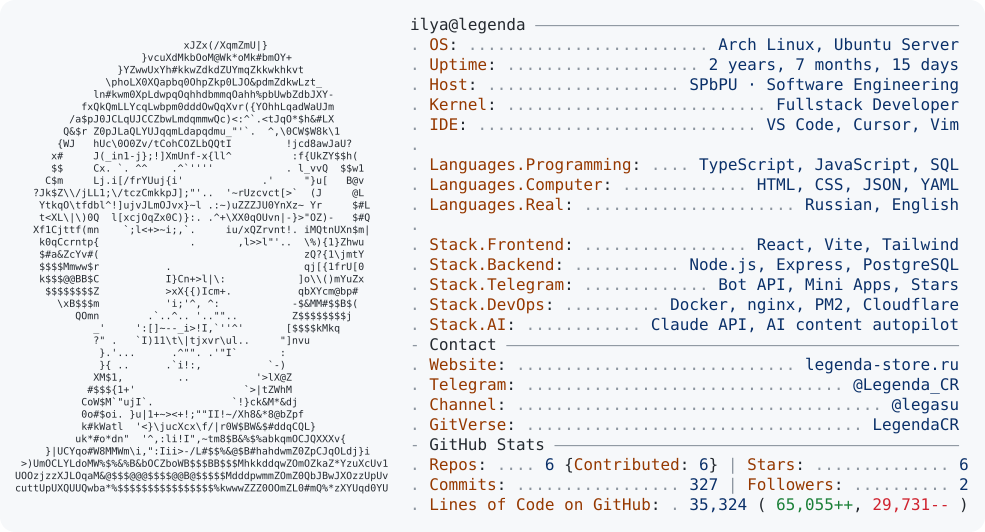
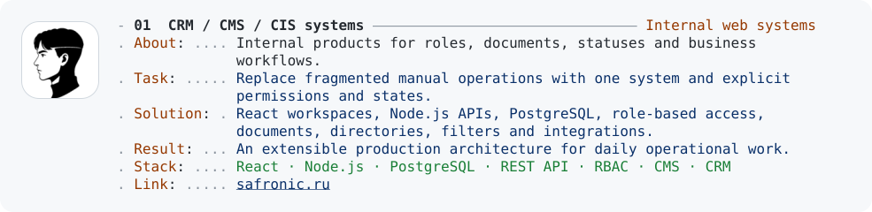
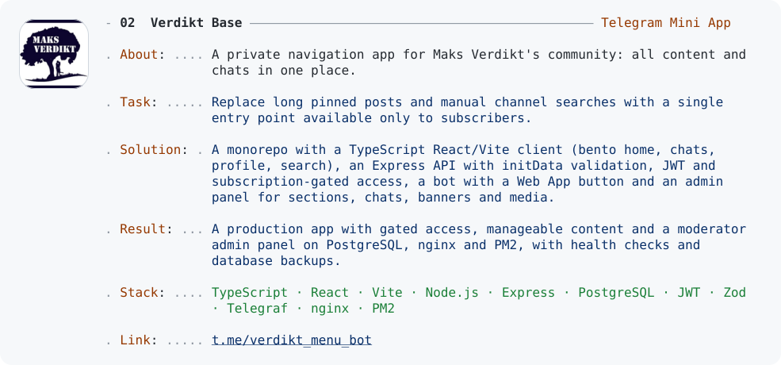
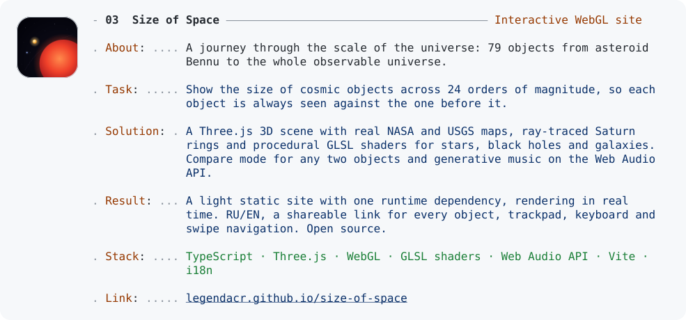
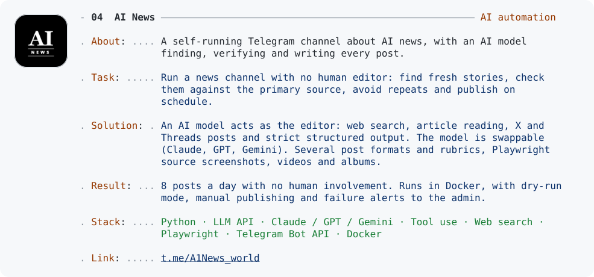
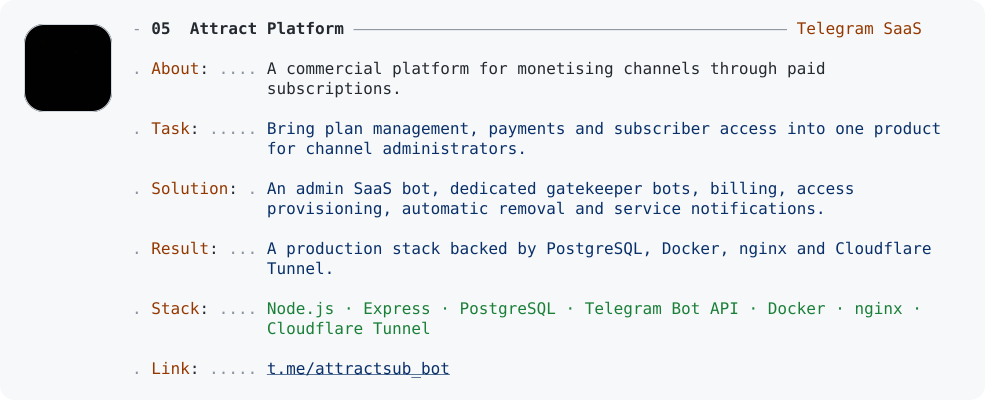
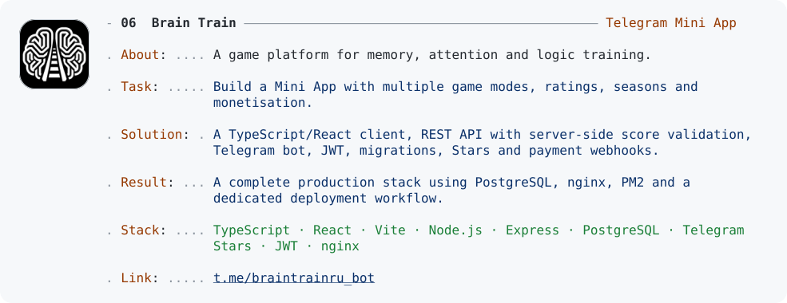
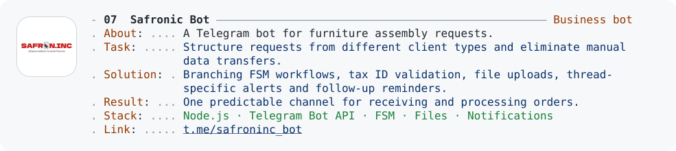
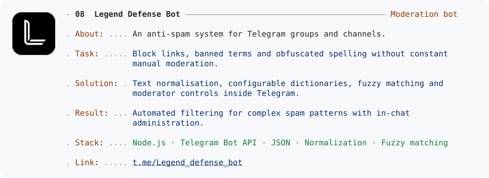
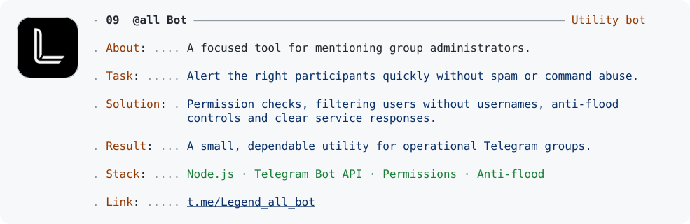

<a href="https://legenda-store.ru">
  <picture>
    <source media="(prefers-color-scheme: dark)" srcset="./dark_mode.svg">
    
  </picture>
</a>

<picture>
  <source media="(prefers-color-scheme: dark)" srcset="./projects/00-header-dark.svg">
  
</picture>

<a href="https://safronic.ru">
<picture>
  <source media="(prefers-color-scheme: dark)" srcset="./projects/01-crm-dark.svg">
  
</picture>
</a>

<a href="https://t.me/verdikt_menu_bot">
<picture>
  <source media="(prefers-color-scheme: dark)" srcset="./projects/02-verdikt-dark.svg">
  
</picture>
</a>

<a href="https://legendacr.github.io/size-of-space/">
<picture>
  <source media="(prefers-color-scheme: dark)" srcset="./projects/03-size-of-space-dark.svg">
  
</picture>
</a>

<a href="https://t.me/A1News_world">
<picture>
  <source media="(prefers-color-scheme: dark)" srcset="./projects/04-ai-news-dark.svg">
  
</picture>
</a>

<a href="https://t.me/attractsub_bot">
<picture>
  <source media="(prefers-color-scheme: dark)" srcset="./projects/05-attract-dark.svg">
  
</picture>
</a>

<a href="https://t.me/braintrainru_bot">
<picture>
  <source media="(prefers-color-scheme: dark)" srcset="./projects/06-brain-train-dark.svg">
  
</picture>
</a>

<a href="https://t.me/safroninc_bot">
<picture>
  <source media="(prefers-color-scheme: dark)" srcset="./projects/07-safronic-dark.svg">
  
</picture>
</a>

<a href="https://t.me/Legend_defense_bot">
<picture>
  <source media="(prefers-color-scheme: dark)" srcset="./projects/08-legend-defense-dark.svg">
  
</picture>
</a>

<a href="https://t.me/Legend_all_bot">
<picture>
  <source media="(prefers-color-scheme: dark)" srcset="./projects/09-all-bot-dark.svg">
  
</picture>
</a>
